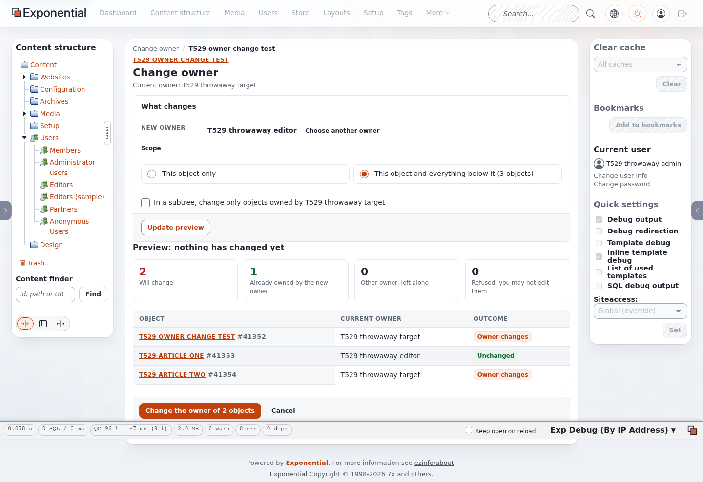

# ezownerchange: change the owner of content in Exponential

ezownerchange changes the owner of content objects in Exponential. Change one object, or every object in a
subtree, from the administration interface or from the command line. Nothing changes before you have seen what
will change: the administration shows a preview (a dry run) and asks you to confirm, and the command line script
has `--dry-run`.

- **One object or a whole subtree.** Start from the context menu ("Change owner") of any node, choose the new owner
  in the content browser, then pick the scope.
- **Preview first.** The preview lists every object the change reaches and what happens to each one: the owner
  changes, it already has the new owner, it belongs to another owner and is left alone, or you may not edit it.
- **Permission checked.** The `owner/change` policy opens the tool, `owner/subtree` allows subtree changes, and each
  object changes only where you may also edit it (`content/edit` with its limitations).
- **Safe writes.** Changes are written in batches, one database transaction per batch. Every changed object gets
  its view cache cleared and goes to the search index. If the content changes between the preview and the
  confirmation, nothing is written and you see the new preview.
- **Audited.** Every change is recorded in the Exponential audit as `content.ezownerchange.change`. A subtree run
  is recorded as a whole as `content.ezownerchange.subtree`.
- **Command line.** `bin/php/expownerchange.php` handles bulk changes of any size, for example "give everything
  one user owns below a node to another user", with `--dry-run`, `--list` and `--batch-size`.
- **Translated.** English (eng-US) and German (ger-DE).



## Requirements

- Exponential 6 (the audit records need Exponential 6.0.15 or later; without the audit, nothing is recorded and
  everything else works)
- PHP 8.0 or later (tested on PHP 8.5)
- ezformtoken switched on, as in every default installation, so that every form carries a form token

## Installation

With Composer, from the root of the installation:

```bash
composer require se7enxweb/ezownerchange:~1.4.0
```

Without Composer, clone the repository into `extension/`:

```bash
git clone https://github.com/se7enxweb/ezownerchange.git extension/ezownerchange
```

New Exponential installations already have the extension and switch it on.

## Activation

Switch it on in `settings/override/site.ini.append.php`:

```ini
[ExtensionSettings]
ActiveExtensions[]=ezownerchange
```

Then regenerate the autoloads and clear the caches:

```bash
php bin/php/ezpgenerateautoloads.php -e
php bin/php/ezcache.php --clear-all
```

Administrators (the Administrator role has every policy) can use it right away. For other roles, see
[doc/permissions.md](doc/permissions.md).

## Quick start

1. In the administration, open the context menu of a node and choose **Change owner**.
2. Choose the new owner in the content browser and click **Select**.
3. Pick **This object only** or **This object and everything below it**, then click **Update preview**.
4. Check the preview, then click **Change the owner of N objects**.

On the command line, preview first and then run the change (here: everything user 41350 owns below node 40067 goes to user 41351; [doc/cli.md](doc/cli.md) shows the output):

```bash
php extension/ezownerchange/bin/php/expownerchange.php --to-owner=41351 --node=40067 --from-owner=41350 --dry-run --list
php extension/ezownerchange/bin/php/expownerchange.php --to-owner=41351 --node=40067 --from-owner=41350
```

## Documentation

| Guide | What it covers |
|---|---|
| [doc/usage.md](doc/usage.md) | The administration: single objects and subtrees, the preview and the confirmation |
| [doc/cli.md](doc/cli.md) | The command line script: every option, with examples and real output |
| [doc/configuration.md](doc/configuration.md) | Every setting and its default |
| [doc/permissions.md](doc/permissions.md) | The policies, with role setups for administrators and editors |
| [doc/audit.md](doc/audit.md) | What the audit records |
| [doc/upgrading.md](doc/upgrading.md) | Changes from releases up to 1.3, and how to migrate |
| [doc/troubleshooting.md](doc/troubleshooting.md) | Common problems and their fixes |
| [CHANGELOG.md](CHANGELOG.md) | Release history |

## Tests

The unit tests need no database:

```bash
cd extension/ezownerchange && php ../../vendor/bin/phpunit
```

## License

GNU General Public License v2.0 or any later version; see [LICENSE](LICENSE). Copyright (C) 1998 - 2026 Exponential Foundation and 7x. All rights reserved.
Based on the owner extension by Kristof Coomans (Copyright (C) 2006 SCK-CEN).
