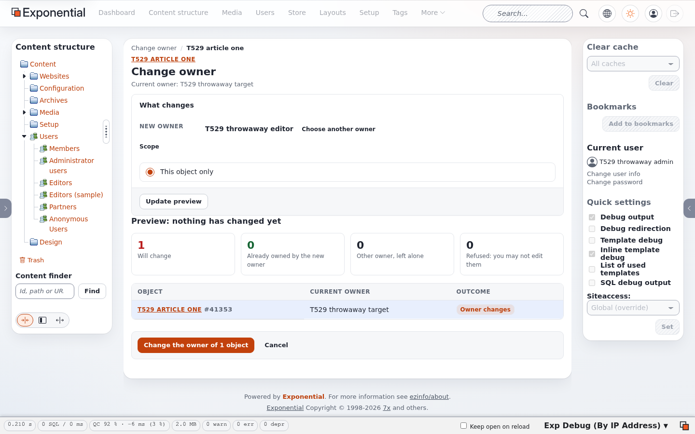
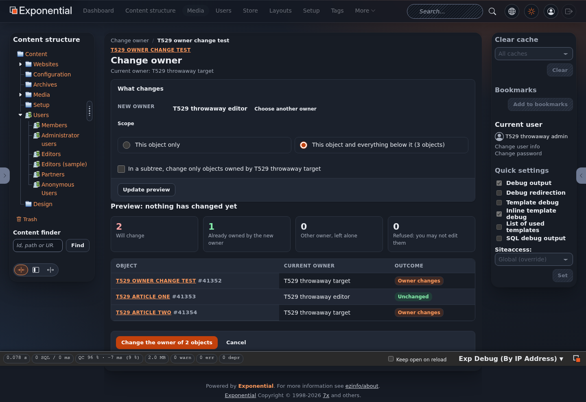
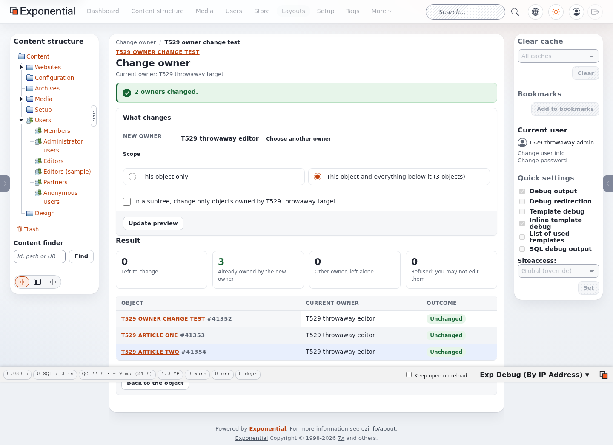
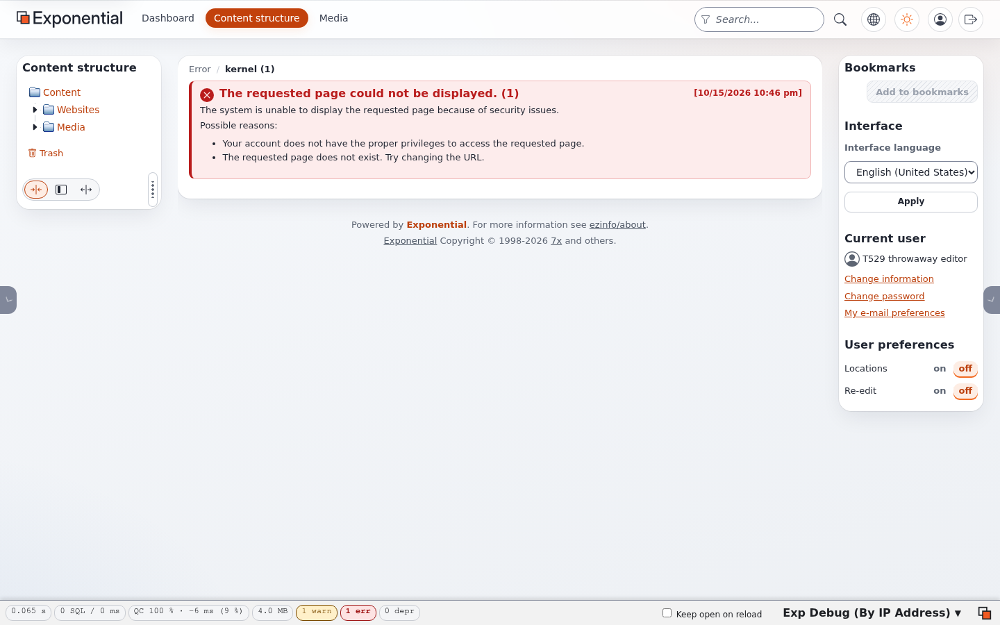

# Changing owners in the administration

Every content object has an owner, the user it belongs to. Exponential shows the owner in the object's details, and
roles can limit what someone may do to "own" content (the `Owner` limitation of `content/edit`, `content/read` and
`content/remove`). ezownerchange changes that owner for one object or for a whole subtree.

The screens below come from the admin4l design. The classic administration, admin3, admin4, the Admin UI and the
editor siteaccess show the same page in their own look, because all of them fall back to the extension's
`design/admin` templates.

## 1. Open the tool

Open the context menu of a node, either in the content structure tree or in the sub-items list of a node, and
choose **Change owner**. The entry appears only for users with the `owner/change` policy.

The menu opens `owner/change/<object id>/(node)/<node id>`. You can also link to that address from your own
templates (see [upgrading.md](upgrading.md) for the template snippet of earlier releases, which still works).

## 2. Choose the new owner

The content browser opens on the Users tree. Go to the user's group, select the user and click **Select**. Only
user accounts can be selected: objects of the classes in `browse.ini [ChangeOwner] Class[]` (by default the class
`user`). Nothing has changed at this point. **Cancel** takes you back to the node.

## 3. The preview

The page shows the current owner and the new owner, the scope, and the preview: how many objects will change, and
a list of the first 200 objects with the outcome for each.

| Figure | Meaning |
|---|---|
| **Will change** | The owner of these objects changes when you confirm |
| **Already owned by the new owner** | Nothing to do for them |
| **Other owner, left alone** | In a subtree with the owner filter on: they belong to someone else and keep their owner |
| **Refused: you may not edit them** | You have no `content/edit` access to them (with its class, section, owner or subtree limitations), so their owner stays |

**Choose another owner** opens the content browser again.

### Scope

- **This object only**: just the object you started from, with all its locations.
- **This object and everything below it (N objects)**: every object with a location in the subtree, the starting
  object included. An object with several locations counts once. This choice needs the `owner/subtree` policy and
  is not shown for a node without children.
- **In a subtree, change only objects owned by ...**: limits a subtree change to the objects the current owner
  of the starting object owns. Use it to hand one person's content over to someone else without touching
  everything else in the subtree.

Click **Update preview** after you change the scope or the filter. Pressing Enter does the same.

A subtree of more than `WebObjectLimit` objects (500 by default) cannot be changed in one request. The page says so
and points to the command line script (see [cli.md](cli.md)).

## 4. Confirm

**Change the owner of N objects** carries out the change shown in the preview. The button appears only when
something will change and the preview has no errors.

The confirmation checks the preview again before it writes. If something changed in the meantime (another owner, a
new child object, a lost permission), nothing is written. The page shows the new preview with the notice "The
content changed after the preview" so that you can check it and confirm again.

The page then shows the result: how many owners changed, and the preview as it is now. Objects that changed now
count as "Already owned by the new owner".

If a batch fails, it is rolled back and the page says how many objects could not be changed. See
[troubleshooting.md](troubleshooting.md).

## What a change does

For each object whose owner changes:

1. `ezcontentobject.owner_id` is set to the new owner, in one database transaction per batch of `BatchSize`
   objects. With `UpdateVersionCreator=enabled`, the creator of the current version changes too. With
   `PublishNewVersion=enabled`, a new version is published instead, as in releases up to 1.3 (see
   [configuration.md](configuration.md)).
2. The object's view caches are cleared (`ClearViewCache`).
3. The object goes to the search engine, because the owner is indexed, for example by ezfind
   (`UpdateSearchIndex`, which follows the site's `DelayedIndexing` setting).
4. The audit records `content.ezownerchange.change` (see [audit.md](audit.md)).

The objects keep their versions, their modification date, their sections and their states.

## Refused

A user without the `owner/change` policy gets the kernel's access denied page (HTTP 403), and the audit records
`access.permission.refused` for `owner/change`:

A user with `owner/change` but without `owner/subtree` who asks for a subtree change gets the preview of the
starting object only, with the notice "You may not change the owner of a whole subtree".

## Forms and tokens

Every step that changes anything is a POST of the page's form. The address alone only opens the content browser.
ezformtoken adds its token to the form, so a change cannot be triggered from another site.
